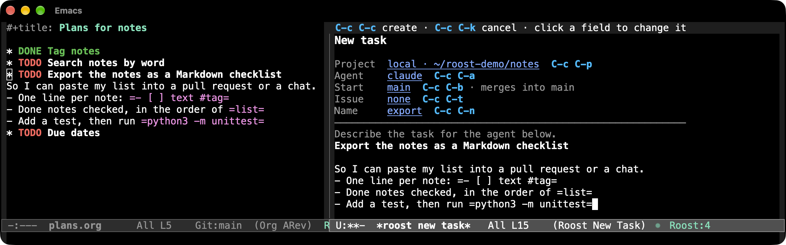
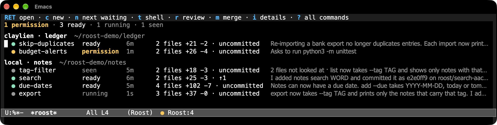
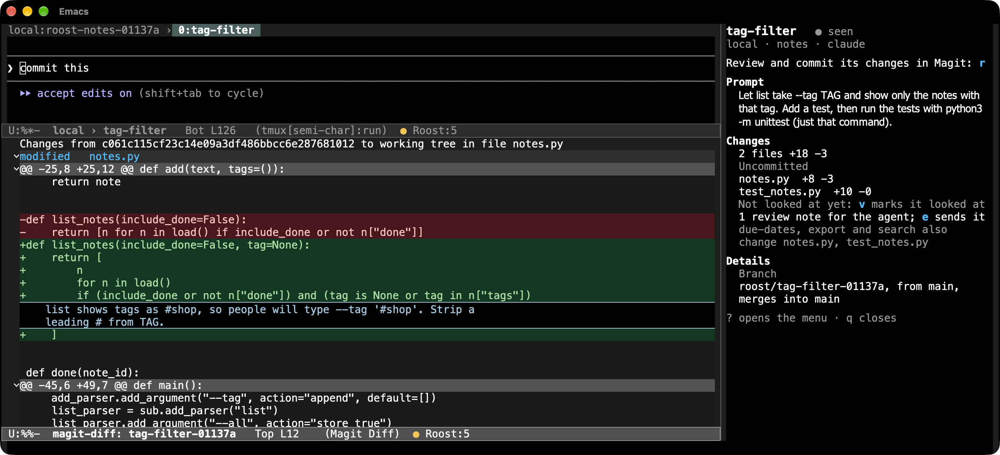

# Roost

[](https://github.com/csheaff/roost/actions/workflows/ci.yml)

**Run a fleet of coding agents from Emacs.** Roost gives each agent
([Claude Code](https://claude.com/claude-code),
[Codex](https://github.com/openai/codex) or
[Pi](https://github.com/earendil-works/pi)) a task of its own: a Git
worktree, a branch and a terminal, here or on any SSH host. It tells you which
agents need you, and you review and merge their work with Magit. If you've
used Orca or Conductor, it's that idea, inside the Emacs you already use.


*Six Claude Code agents on two machines. The one on `claylien` wants to run
its tests: its own terminal in the middle, every task at the left, and at the
right what to do next, what you asked it and what it changed.*

Other Emacs packages run coding agents too, among them
[agent-shell](https://github.com/xenodium/agent-shell),
[claude-code.el](https://github.com/stevemolitor/claude-code.el) and
[M-x Machina](https://github.com/eliraz-refael/m-x-machina). Roost differs in
three ways:

- **Agents run outside Emacs.** Each one runs in tmux, and Emacs shows its
  terminal. Restart Emacs, and an agent at work is still at work, rather than
  resumed from its saved conversation.
- **On any machine you can reach over SSH.** One dashboard covers this
  machine and your remote hosts, and Magit reviews their work over TRAMP,
  fastest with [tramp-rpc](docs/manual.md#fitting-your-setup).
  Close the laptop, and a remote agent carries on.
- **It sees a task through.** Each task has its own worktree and branch. You
  review it in Magit and send notes on its lines back to the agent; Roost
  brings it up to date, merges it or opens a pull request, and cleans up.

Each agent keeps its own terminal interface, so its prompts, menus and slash
commands work as they always do, new ones included. Roost adds what lives
outside the agent, starting with which agents are waiting for you: `n` takes
you to the next.

## How it goes

**Start where the work is.** `c` drafts a task. An Org heading, a selected
region or a GitHub issue becomes its prompt, and `C-c C-c` makes the worktree
and starts the agent.



**Watch them all.** `M-x roost-status` lists every agent on every host: what
it's doing, what it changed, and its latest reply or what it asks. A
notification says the same when one finishes or asks for something, and `RET`
opens its terminal.



**Review, and reply in place.** `r` opens Magit on the task's worktree, over
TRAMP for a remote one, with the agent's latest reply at the top. Stage what
you've checked; `;`, or the `+` beside a line, writes a note for the agent
on it, and `@` sends it your notes.

<p align="center"></p>

**Finish.** `m` squashes the task into the branch it started from and removes
its worktree, branch and terminal. `u` brings it up to date first, with its
agent resolving any conflicts, and `P` opens a pull request instead.

## Get started

Roost needs Emacs 29.1 or newer and
[tmux-control](https://github.com/csheaff/tmux-control) 0.7.0 or newer. Each
host needs Python 3.9+, Git, tmux 3.1+ and a signed-in agent CLI; remote hosts
need SSH with keys or an agent. With Emacs 30:

```elisp
(use-package tmux-control
  :vc (:url "https://github.com/csheaff/tmux-control" :rev :newest))

(use-package roost
  :vc (:url "https://github.com/csheaff/roost" :rev :newest)
  :demand t
  :bind ("C-c r" . roost-dispatch)          ; the menu, from anywhere
  :custom (roost-hosts '(nil "devbox"))     ; nil is this machine
  :config
  (roost-watch-mode 1)                      ; notice waiting agents from startup
  (roost-sidebar-mode 1)                    ; the task list at the left
  (roost-task-panel-mode 1))                ; a task's panel beside its terminal
```

For straight.el, Doom, Emacs 29, Evil and other modal setups, see the
[manual](docs/manual.md#install).

1. `M-x roost-doctor` checks this machine and each host, with a fix for
   anything missing.
2. In a Git project, `C-c r c`, write a prompt, and `C-c C-c`.
3. Answer the agent in its terminal. `C-c ?` there opens Roost's menu.

| Key | | Key | |
| --- | --- | --- | --- |
| `c` | New task | `r` | Review in Magit |
| `n` | Next agent waiting for you | `u` | Bring a task up to date |
| `RET` | The agent's terminal | `m` | Merge it, and clean up |
| `t` | A shell in its worktree | `P` | Open a pull request |
| `e` | Send the agent a prompt | `x` | Finish: retire, or discard |
| `/` | Search agents' conversations | `?` | Every command |

These work in the dashboard, the sidebar and a task's panel, and on the menu.

## Good to know

- Roost is built around Claude Code and checked against each new release of
  it. Codex and Pi tasks work with less: Codex asks before each commit and
  reports nothing until its first turn, and Pi is experimental.
- Roost never answers an agent's prompts, never changes your global agent
  settings, and never stages or commits your work. It deletes work only when
  you discard a task and type its name.
- Claude Code starts in auto mode for some accounts and rarely asks. To be
  asked before each command, add `"--permission-mode" "manual"` to its entry
  in `roost-agent-commands`.

## More

- [The manual](docs/manual.md): every command and option, a day of work in
  detail, and how Roost works.
- [Changes](CHANGELOG.md), with what to do when upgrading.
- [A possible roadmap](docs/roadmap.md): ideas being considered, and the
  tools they come from.
- [Validation](docs/validation.md): live runs with Claude Code and Codex, on
  local and remote hosts. [How the screenshots were made](docs/demo.md), and
  [the MELPA recipes](docs/melpa.md).

[Orca](https://www.onorca.dev/) shaped the workflow: a worktree per task, a
terminal nearby, review before finishing. See the
[comparison](docs/orca-comparison.md).

## License

GPL-3.0-or-later.
